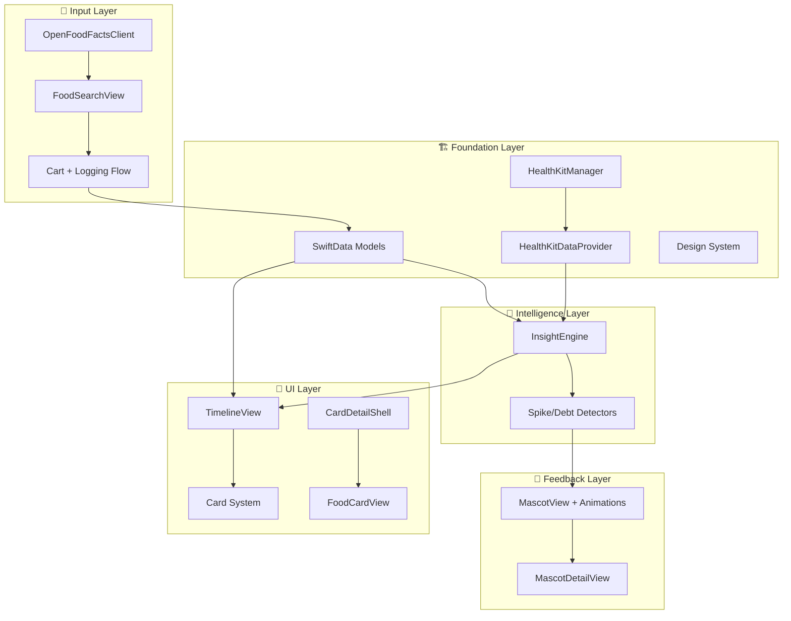

# Monch — Full Project Decomposition

**Status:** Decomposed  
**Last Updated:** 2026-01-04  
**Sprint Status:** 5/6 Planned Sprints Completed

---

## Vision Recap

Monch is an iOS application that transforms food logging from a chore into a **discovery engine**. By correlating food logs with wearable biomarkers (HR, HRV, Sleep), it identifies novel insights that help users understand their unique metabolic responses — connecting what they eat to how they feel.

**Core Philosophy:** "Cozy Science" — Emotional mascot-driven UI, watercolor aesthetics, direct actionable copy.

---

## Project Architecture



---

## What's Done ✅

### Sprint 1: Foundation (Complete)
| Feature | File | Status |
|---------|------|--------|
| SwiftData Models | `MealLog.swift`, `InsightEvent.swift`, `MascotStateLog.swift`, `CartItem.swift` | ✅ |
| Design System | `Color+Monch.swift`, `Font+Monch.swift`, `Spacing.swift`, `CornerRadius.swift`, `Typography.swift` | ✅ |
| MeshGradient Backgrounds | `MeshGradientBackground.swift` | ✅ |
| HealthKit Permission Request | `HealthKitManager.swift` | ✅ |
| HealthKit Data Reader | `HealthKitManager.swift` (fetchHR, fetchHRV, fetchSleep, etc.) | ✅ |
| Backfill Convenience Method | `HealthKitManager.backfillLastSevenDays()` | ✅ |

> **Review Verdict:** [Approved](file:///Users/ananthradhakrishnan/Documents/Projects/Monch/brain/sprint1_review.md) — No critical issues.

---

### Sprint 2: Timeline UI + Mascot (Complete)
| Feature | File | Status |
|---------|------|--------|
| Timeline View Shell | `TimelineView.swift` | ✅ |
| Day Header Component | `DayHeader.swift` | ✅ |
| Empty State (Ghost Timeline) | `EmptyTimelineView.swift` | ✅ |
| Basic Navigation | Tab-based in `ContentView.swift` | ✅ |
| Mascot Header Component | `MascotHeader.swift` | ✅ |
| Mascot Animation System | `MascotView.swift` (idle, breathing, state-specific) | ✅ |
| The Monch View (Detail Sheet) | `MascotDetailView.swift` | ✅ |
| All 7 Mascot States | InApp + 8Bit assets in `Assets.xcassets/Monch/` | ✅ |

> **Review Verdict:** [Approved](file:///Users/ananthradhakrishnan/Documents/Projects/Monch/brain/sprint2_review.md) — Clean animation implementation.

---

### Sprint 3: Food Logging (Complete)
| Feature | File | Status |
|---------|------|--------|
| Food Search API Client | `OpenFoodFactsClient.swift` | ✅ |
| Food Search UI | `FoodSearchView.swift` | ✅ |
| Search ViewModel | `FoodSearchViewModel.swift` | ✅ |
| Debounced Search | Implemented in ViewModel | ✅ |
| Meal Logging Flow | ViewModel → SwiftData | ✅ |
| Quick-Add Buttons | Caffeine, common items | ✅ |

> **Review Verdict:** [Approved](file:///Users/ananthradhakrishnan/Documents/Projects/Monch/brain/sprint3_review.md) — Clean async actor pattern.

---

### Sprint 4: Intelligence (Complete)
| Feature | File | Status |
|---------|------|--------|
| Insight Engine Actor | `InsightEngine.swift` | ✅ |
| Sugar Spike Detector | `InsightEngine.detectSugarSpike()` | ✅ |
| Digestion Debt Detector | `InsightEngine.detectDigestionDebt()` | ✅ |
| Predicted Insights (Immediate) | `createPredictedSugarSpike()` | ✅ |
| Mood Mapping | InsightType → MascotMoodState | ✅ |
| HealthKit Data Provider | `HealthKitDataProvider.swift` | ✅ |

> **Review Verdict:** [Approved](file:///Users/ananthradhakrishnan/Documents/Projects/Monch/brain/sprint4_review.md) — First brain layer working.

---

### Sprint 5: Timeline Cards Shell (Complete)
| Feature | File | Status |
|---------|------|--------|
| CardDetailShell (Reusable) | `CardDetailShell.swift` | ✅ |
| FoodCardView | `FoodCardView.swift` | ✅ |
| Serving Size Multiplier | 0.5x, 1x, 1.5x, 2x | ✅ |
| Macro Recalculation | Live scaling | ✅ |
| Fiber/Sugar Hierarchy | Nested under Carbs | ✅ |
| Micronutrients (Expandable) | Collapsible section | ✅ |
| Timeline Integration | Tap meal → Sheet | ✅ |
| CornerRadius.xl Token | `Spacing.swift` | ✅ |

> **Review Verdict:** [Approved](file:///Users/ananthradhakrishnan/Documents/Projects/Monch/brain/sprint5_review.md) — Clean, reusable architecture.

---

## Gaps & Incomplete Features 🚧

### High Priority (P0 — MVP Blocking)

| Feature | Spec Reference | Gap Description |
|---------|----------------|-----------------|
| **Muscle Sponge Detector** | FEATURE-BREAKDOWN.md #13 | Algorithm for post-workout anabolic window NOT implemented |
| **Good Spike Suppression** | FEATURE-BREAKDOWN.md #14 | Suppress sugar spike alerts during exercise NOT implemented |
| **Insight Card Component** | FEATURE-BREAKDOWN.md #17 | Only placeholder exists (`InsightCardPlaceholder`) — needs full design |

### Medium Priority (P1 — Should Have)

| Feature | Spec Reference | Gap Description |
|---------|----------------|-----------------|
| **SleepCard** | Timeline_Cards_UX.md | Not implemented — needs hypnogram visualization |
| **ExerciseCard** | Timeline_Cards_UX.md | Not implemented — needs HR zone breakdown |
| **InsightCard (Detail)** | Timeline_Cards_UX.md | Not implemented — needs linked entries + quick actions |
| **SubjectiveCard** | Timeline_Cards_UX.md | Not implemented — Vibe Check modal for energy/mood logging |
| **MascotDetailView Data** | Sprint 2 Review Note | Currently hardcoded ("45 min ago", "+12 bpm") — needs real data wiring |
| **Caffeine Quick-Add** | FEATURE-BREAKDOWN.md #19 | Partial — button exists, needs dedicated UX flow |
| **Supplement Stack Quick-Add** | FEATURE-BREAKDOWN.md #20 | Not implemented |
| **Workout Passive Sync** | FEATURE-BREAKDOWN.md #21 | HealthKit reader exists, but Timeline integration missing |
| **Refeed Context Tagging** | FEATURE-BREAKDOWN.md #22 | Algorithm exists in spec, not connected to meals |
| **Circadian Context Tagging** | FEATURE-BREAKDOWN.md #23 | Algorithm exists in spec, not implemented |
| **Notification System** | FEATURE-BREAKDOWN.md #24-27 | No notification infrastructure yet |
| **Historical Date Navigation** | FEATURE-BREAKDOWN.md #34 | Timeline only shows current data, no date picker |
| **Meal Edit/Delete Swipe Actions** | FEATURE-BREAKDOWN.md #35 | Sheet-based delete only, no swipe actions |
| **Summary Views (Day/Week/Month)** | FEATURE-BREAKDOWN.md #52 | Not implemented |

### Low Priority (P2 — Nice to Have)

| Feature | Gap Description |
|---------|-----------------|
| Barcode Scanner | Not implemented |
| Live Activity Widget | Not implemented |
| Advanced Detectors (Anxiety Mimic, Caffeine Jitter, Zone 2 Drain, etc.) | Not implemented |
| River Card Styling (Bubble backgrounds, watercolor assets) | Basic styling only |
| Custom Haptic Patterns | Not implemented |
| Onboarding Flow | Not implemented |
| App Icon & Launch Screen | Placeholder only |
| Mock Data Seeder | Not implemented (simulator development limited) |

---

## Design System Gaps

| Component | Specified In | Implementation Status |
|-----------|--------------|----------------------|
| `MonchAvatar` (single source of truth) | Design_System.md §10 | Partial — `MascotView.swift` exists but not abstracted as reusable `MonchAvatar` |
| `InsightCard` (full component) | Design_System.md §10 | Placeholder only |
| `RiverTimeline` (styled bubbles) | Design_System.md §7.1 | Basic LazyVStack, no watercolor/bubble styling |
| `MoodGradientBackground` | Design_System.md §10 | ✅ Exists as `MeshGradientBackground` |
| `SplineAreaChart` | Design_System.md §7.4 | Not implemented |
| `MonchButton` (variants) | Design_System.md §7.3 | Not implemented — using stock SwiftUI buttons |

---

## Upcoming Work 📋

### Sprint 6: Card System Completion (Recommended)

Reuse `CardDetailShell` for remaining card types:

1. **SleepCard**
   - Hypnogram bar chart
   - Duration/quality metrics
   - Context linking (late meals)

2. **ExerciseCard**
   - HR zone breakdown
   - Anabolic window indicator
   - Refeed tag display

3. **InsightCard (Detail)**
   - Replace placeholder
   - Linked entries section
   - Quick actions (Start Walk, Log Snack)

4. **Wire MascotDetailView to real data**
   - Last meal timestamp
   - HR delta from baseline

### Sprint 7: Context & Passive Intelligence

1. **Muscle Sponge Detector**
   - Detect post-workout window
   - Tag meals as "refeed"

2. **Good Spike Suppression**
   - Suppress sugar spike during exercise
   - Check workout mode flag

3. **Workout Passive Sync**
   - Auto-import workouts to timeline
   - Display as ExerciseCard

4. **Refeed + Circadian Context Tagging**
   - Auto-tag meals based on time proximity

### Sprint 8: Notifications & Nudges

1. **Notification Permission Request**
2. **Push Notification Scheduler**
3. **Kitchen Closing Nudge**
4. **Sugar Spike Alert Notification**

### Sprint 9: Subjective Calibration

1. **Vibe Check Modal** (Energy/Focus/Mood sliders)
2. **SubjectiveCard**
3. **Symptom Tagging**
4. **Correlation with insights**

### Sprint 10: Polish & Release

1. **Onboarding Flow** (Privacy Handshake)
2. **App Icon Finalization**
3. **Summary Views** (Day/Week/Month aggregates)
4. **River Card Styling** (Watercolor assets)
5. **Historical Navigation**

---

## Technical Debt & Warnings

| Issue | Source | Severity |
|-------|--------|----------|
| Swift 6 Sendable conformance | Sprint 3, 4 Reviews | 🟡 Medium — Address before Swift 6 migration |
| Animation stacking on rapid mood changes | Sprint 2 Review | 🟡 Medium — Monitor in testing |
| No offline handling for food search | Sprint 3 Review | 🟡 Medium — Add offline banner for v2 |
| Force-unwrap in date calculations | Sprint 1 Review | 🟢 Low — Non-blocking |
| NutritionData struct refactor | Sprint 1 Review | 🟢 Low — Defer to v2 |

---

## File Inventory

### Source Files (26 Swift Files)

```
monch/
├── monchApp.swift                    # App entry point
├── ContentView.swift                 # Root navigation
├── DesignSystem/
│   ├── Color+Monch.swift            ✅
│   ├── CornerRadius.swift           ✅
│   ├── Font+Monch.swift             ✅
│   ├── MeshGradientBackground.swift ✅
│   ├── Spacing.swift                ✅
│   └── Typography.swift             ✅
├── Managers/
│   └── HealthKitManager.swift       ✅
├── Models/
│   ├── CartItem.swift               ✅
│   ├── InsightEvent.swift           ✅
│   ├── MascotStateLog.swift         ✅
│   └── MealLog.swift                ✅
├── Services/
│   ├── HealthKitDataProvider.swift  ✅
│   ├── InsightEngine.swift          ✅
│   └── OpenFoodFactsClient.swift    ✅
└── Views/
    ├── Cards/
    │   ├── CardDetailShell.swift    ✅
    │   └── FoodCardView.swift       ✅
    ├── FoodLogger/
    │   ├── FoodSearchView.swift     ✅
    │   └── FoodSearchViewModel.swift ✅
    ├── Mascot/
    │   ├── MascotDetailView.swift   ✅
    │   ├── MascotHeader.swift       ✅
    │   └── MascotView.swift         ✅
    └── Timeline/
        ├── DayHeader.swift          ✅
        ├── EmptyTimelineView.swift  ✅
        └── TimelineView.swift       ✅
```

### Assets

```
Assets.xcassets/
├── Monch/
│   ├── InApp/            # 7 watercolor states (PNG)
│   └── 8Bit/             # 7 pixel art states (PNG)
├── AppIcon.appiconset/   # Placeholder
└── AccentColor.colorset/ # Theme accent
```

### Documentation

| File | Purpose |
|------|---------|
| [FEATURE-BREAKDOWN.md](file:///Users/ananthradhakrishnan/Documents/Projects/Monch/specs/FEATURE-BREAKDOWN.md) | Complete feature specs (54 features) |
| [Design_System.md](file:///Users/ananthradhakrishnan/Documents/Projects/Monch/Design_System.md) | Design tokens & component specs |
| [Mascot_UX.md](file:///Users/ananthradhakrishnan/Documents/Projects/Monch/Mascot_UX.md) | Mascot behavior & animation spec |
| [Timeline_Cards_UX.md](file:///Users/ananthradhakrishnan/Documents/Projects/Monch/Timeline_Cards_UX.md) | Card type specifications |
| [Backlog.md](file:///Users/ananthradhakrishnan/Documents/Projects/Monch/Backlog.md) | Engineering phases overview |
| [Insights_Library.md](file:///Users/ananthradhakrishnan/Documents/Projects/Monch/Insights_Library.md) | Insight algorithms & copy |
| [User Scenarios](file:///Users/ananthradhakrishnan/Documents/Projects/Monch/User%20Scenarios%20-%20Core%20Utility.md) | Core user journeys |

---

## Summary Progress

```
█████████████░░░░░░░░░░░░  ~52%  Overall MVP
████████████████████████░  ~96%  Foundation Complete
████████████████████████░  ~96%  Timeline UI Complete
████████████████████████░  ~96%  Food Logging Complete
██████████████░░░░░░░░░░░  ~60%  Intelligence Layer
██████████░░░░░░░░░░░░░░░  ~40%  Card System
░░░░░░░░░░░░░░░░░░░░░░░░░   ~0%  Notifications
░░░░░░░░░░░░░░░░░░░░░░░░░   ~0%  Subjective Calibration
░░░░░░░░░░░░░░░░░░░░░░░░░   ~0%  Polish & Release
```

---

## Next Recommended Action

**Sprint 6: Complete the Card System**

The `CardDetailShell` is ready for reuse. Focus on:
1. `SleepCard` — High visibility for morning review flow
2. `ExerciseCard` — Required for anabolic window feature
3. Full `InsightCard` — Replace placeholder with linked entries

This unblocks the remaining intelligence features (Muscle Sponge, Refeed tagging) which require the card UI to display their output.
