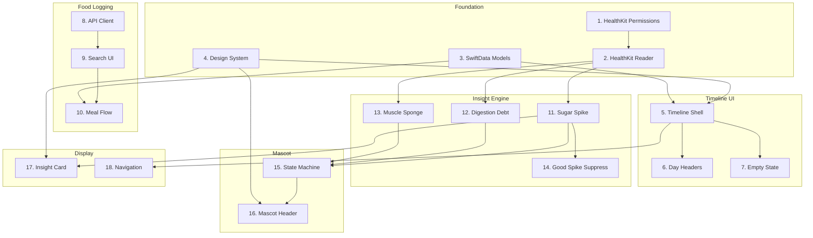

# Monch — Feature Breakdown

**Version:** 1.0  
**Status:** Draft — Awaiting Approval  
**Created:** 2026-01-03

---

## Vision

Monch is an iOS application that transforms food logging from a chore into a **discovery engine**. By correlating food logs with wearable biomarkers (HR, HRV, Sleep), the app identifies novel insights that help users understand their unique metabolic responses—connecting what they eat to how they feel.

**Core Philosophy:** "Cozy Science" — Emotional mascot-driven UI, watercolor aesthetics, direct actionable copy.

---

## User Journeys

1. **Onboarding & Data Acquisition** — User grants HealthKit permissions, app backfills 7 days of baseline data
2. **Food Logging** — User logs meals via quick-add, search, or supplement stacks
3. **Passive Context Capture** — System auto-imports workouts, tags meals contextually (refeed, circadian)
4. **Insight Delivery** — Engine correlates food→biomarkers, delivers insights via notifications/timeline
5. **Morning Review** — User reviews sleep quality and previous day's causal connections
6. **Subjective Calibration** — User logs energy/mood to ground-truth biological predictions

---

## Feature List (Summary)

### P0 — Must Have (MVP Critical)
| # | Feature | Category | Effort |
|---|---------|----------|--------|
| 1 | HealthKit Permission Request | Foundation | S |
| 2 | HealthKit Data Reader (HR, HRV, Sleep, Workout) | Foundation | M |
| 3 | SwiftData Models (MealLog, InsightEvent, MascotState) | Foundation | S |
| 4 | Design System (Colors, Fonts, MeshGradient) | Foundation | S |
| 5 | Timeline View Shell (River UI) | UI | M |
| 6 | Day Header Component | UI | XS |
| 7 | Empty State (Ghost Timeline) | UI | S |
| 8 | Food Search API Client (OpenFoodFacts) | Input | M |
| 9 | Food Search UI (Bar + Results List) | Input | M |
| 10 | Meal Logging Flow (Add to Cart → Save) | Input | M |
| 11 | Sugar Spike Detector Algorithm | Engine | M |
| 12 | Digestion Debt Detector Algorithm | Engine | M |
| 13 | Muscle Sponge Detector (Anabolic Window) | Engine | S |
| 14 | Good Spike Suppression Logic | Engine | S |
| 15 | Mascot State Machine | UI | M |
| 16 | Mascot Header Component | UI | S |
| 17 | Insight Card Component (Timeline) | UI | M |
| 18 | Basic Navigation (Tab or Sheet) | UI | S |

### P1 — Should Have
| # | Feature | Category | Effort |
|---|---------|----------|--------|
| 19 | Caffeine Quick-Add Button | Input | XS |
| 20 | Supplement Stack Quick-Add | Input | S |
| 21 | Workout Passive Sync | Context | M |
| 22 | Refeed Context Tagging | Context | S |
| 23 | Circadian Context Tagging | Context | S |
| 24 | Notification Permission Request | Feedback | XS |
| 25 | Push Notification Scheduler | Feedback | M |
| 26 | Kitchen Closing Nudge | Feedback | S |
| 27 | Sugar Spike Alert Notification | Feedback | S |
| 28 | Anxiety Mimic Detector | Engine | M |
| 29 | Caffeine Jitter Detector | Engine | M |
| 30 | Zone 2 Drain Detector | Engine | S |
| 31 | Deep Sleep Robber Detector | Engine | M |
| 32 | Sleep Card Component | UI | S |
| 33 | Hypnogram Visualization | UI | M |
| 34 | Historical Date Navigation | UI | S |
| 35 | Meal Edit/Delete (Swipe Actions) | Input | S |

### P2 — Nice to Have
| # | Feature | Category | Effort |
|---|---------|----------|--------|
| 36 | Barcode Scanner | Input | L |
| 37 | Vibe Check Modal (Energy/Focus/Mood) | Calibration | M |
| 38 | Symptom Tagging | Calibration | S |
| 39 | Live Activity Widget (Dynamic Island) | Feedback | L |
| 40 | Lipid Load Detector | Engine | S |
| 41 | Metabolic Burn Detector | Engine | S |
| 42 | Recovery Gap Detector | Engine | M |
| 43 | Tryptophan Trap Detector | Engine | S |
| 44 | Brain Fog Forecast | Engine | M |
| 45 | Stress Buffer Detector | Engine | S |
| 46 | Mineral Gap Detector | Engine | M |
| 47 | River Card Styling (Bubbles/Watercolor) | UI Polish | M |
| 48 | Custom Haptic Patterns | UI Polish | S |
| 49 | Onboarding Flow (Privacy Handshake) | Onboarding | M |
| 50 | App Icon & Launch Screen | Release | S |
| 51 | Mock Data Seeder (Debug) | Dev Tools | M |

---

## Detailed Feature Specs

### P0 Features (MVP)

---

#### 1. HealthKit Permission Request

**Priority**: P0  
**Depends On**: None (First feature)  
**Estimated Effort**: S (1-2 hours)

##### Description
Request read permissions for HealthKit data types required by the insight engine: Heart Rate, Resting HR, HRV, Sleep, Workouts, and Wrist Temperature (if available).

##### Acceptance Criteria
- [ ] GIVEN the app launches for the first time WHEN the user reaches the permission screen THEN a clear value proposition is displayed
- [ ] GIVEN the user taps "Allow" WHEN the system dialog appears THEN all required data types are requested
- [ ] GIVEN permission is granted THEN the app proceeds to backfill 7 days of baseline data
- [ ] GIVEN permission is denied THEN the app shows an explanation with option to retry via Settings

##### Edge Cases
- User denies permission entirely → Show "Limited Mode" explanation
- User grants partial permissions → Graceful degradation (disable insights requiring missing data)
- HealthKit not available (iPad without paired Watch) → Show incompatibility message

##### Technical Notes
- Use `HKHealthStore.requestAuthorization()`
- Privacy usage descriptions in Info.plist with "Privacy-First" messaging
- Check `HKHealthStore.isHealthDataAvailable()` first

---

#### 2. HealthKit Data Reader

**Priority**: P0  
**Depends On**: #1 (Permission Request)  
**Estimated Effort**: M (2-4 hours)

##### Description
Actor-based reader service with convenience methods for fetching granular health data: `fetchHeartRate()`, `fetchHRV()`, `fetchSleep()`, `fetchWorkouts()`, `fetchWristTemp()`.

##### Acceptance Criteria
- [ ] GIVEN permissions are granted WHEN `fetchHeartRate(for: dateRange)` is called THEN HR samples are returned with timestamps
- [ ] GIVEN a 7-day backfill is triggered THEN all data types are fetched and available for the engine
- [ ] GIVEN no data exists for a time range THEN an empty array is returned (not an error)
- [ ] GIVEN the Watch is charging WHEN data is synced THEN the reader picks up new samples

##### Edge Cases
- Query returns very large dataset (10k+ samples) → Batch processing with progress indicator
- HealthKit query fails (rare) → Retry with exponential backoff, log error
- User's device has no HR data (no Watch) → Graceful degradation

##### Technical Notes
- Use Swift `actor` for thread safety
- `HKSampleQuery` for point-in-time, `HKStatisticsQuery` for aggregates
- Consider `HKObserverQuery` for real-time updates (P1)

---

#### 3. SwiftData Models

**Priority**: P0  
**Depends On**: None  
**Estimated Effort**: S (1-2 hours)

##### Description
Define the local persistence schema using SwiftData for iOS 17+.

##### Data Model

**MealLog**
- `id`: UUID
- `timestamp`: Date
- `carbs`: Double (grams)
- `fat`: Double (grams)
- `protein`: Double (grams)
- `name`: String
- `contextTags`: [String] (e.g., "refeed", "circadian")

**InsightEvent**
- `id`: UUID
- `type`: InsightType (enum: sugarSpike, digestionDebt, etc.)
- `timestamp`: Date
- `associatedMealId`: UUID?
- `severity`: InsightSeverity (low, medium, high)
- `message`: String
- `dismissed`: Bool

**MascotState**
- `id`: UUID
- `currentMood`: MascotMood (enum: neutral, spiking, sleepy, strong, etc.)
- `timestamp`: Date

##### Acceptance Criteria
- [ ] GIVEN a MealLog is saved THEN it persists across app launches
- [ ] GIVEN an InsightEvent references a MealLog THEN the relationship is queryable
- [ ] GIVEN SwiftData migrations occur THEN data is preserved

##### Edge Cases
- Corrupt database → Reset and notify user
- Schema migration fails → Graceful fallback

---

#### 4. Design System

**Priority**: P0  
**Depends On**: None  
**Estimated Effort**: S (1-2 hours)

##### Description
Implement the "Cozy Science" design tokens: color palette, typography, and mesh gradient utilities.

##### Components
- `Color.monchCoral` / `Color.monchPeach` (Acute Loop)
- `Color.monchSage` / `Color.monchMint` (Recovery Loop)
- `Color.monchPeriwinkle` / `Color.monchLavender` (Sleep Loop)
- `Color.monchMidnight` / `Color.monchCream` (Backgrounds)
- `Font.monchTitle` / `Font.monchBody` (SF Pro Rounded)
- `MeshGradientBackground` view component

##### Acceptance Criteria
- [ ] GIVEN I use `Color.monchCoral` THEN it renders as `#FFA07A`
- [ ] GIVEN I use `Font.monchTitle` THEN it renders as SF Pro Rounded Bold
- [ ] GIVEN I use `MeshGradientBackground(mood: .acute)` THEN a coral-peach gradient renders

##### Technical Notes
- Use SwiftUI `MeshGradient` (iOS 18) for fluid backgrounds
- Provide fallback gradient for iOS 17

---

#### 5. Timeline View Shell (River UI)

**Priority**: P0  
**Depends On**: #3 (SwiftData Models), #4 (Design System)  
**Estimated Effort**: M (2-4 hours)

##### Description
The main scrollable timeline showing the day's events (meals, insights, context) in chronological order.

##### Acceptance Criteria
- [ ] GIVEN the user opens the app THEN the timeline is visible with today's events
- [ ] GIVEN there are multiple events THEN they are ordered chronologically (newest at top or bottom—TBD)
- [ ] GIVEN the user scrolls THEN performance remains smooth (60fps)
- [ ] GIVEN events span multiple days THEN day headers separate them

##### Edge Cases
- Timeline is empty → Show Ghost Timeline (feature #7)
- Very long timeline (100+ items) → Lazy loading / pagination

##### Technical Notes
- Use SwiftUI `LazyVStack` with `ScrollView`
- Section by day using `ForEach` with grouping

---

#### 6. Day Header Component

**Priority**: P0  
**Depends On**: #5 (Timeline View)  
**Estimated Effort**: XS (<1 hour)

##### Description
A sticky or inline header separating days in the timeline (e.g., "Today", "Yesterday", "Mon, Jan 2").

##### Acceptance Criteria
- [ ] GIVEN events from multiple days THEN headers appear between them
- [ ] GIVEN today's events THEN the header shows "Today"
- [ ] GIVEN yesterday's events THEN the header shows "Yesterday"

---

#### 7. Empty State (Ghost Timeline)

**Priority**: P0  
**Depends On**: #5 (Timeline View)  
**Estimated Effort**: S (1-2 hours)

##### Description
When no data exists, show a pulsing "ghost" visualization prompting the user to log their first meal.

##### Acceptance Criteria
- [ ] GIVEN the timeline is empty THEN a ghost prompt appears: "Your metabolic story starts with breakfast. Log your first meal."
- [ ] GIVEN the prompt is tapped THEN the food logger opens

---

#### 8. Food Search API Client (OpenFoodFacts)

**Priority**: P0  
**Depends On**: None  
**Estimated Effort**: M (2-4 hours)

##### Description
Networking client to search the OpenFoodFacts API for food items and parse nutritional data.

##### Acceptance Criteria
- [ ] GIVEN a search query "Oatmeal" WHEN the API is called THEN results with name, carbs, fat, protein are returned
- [ ] GIVEN a product barcode WHEN the API is called THEN the product details are returned
- [ ] GIVEN the network is unreachable THEN an appropriate error is returned (not a crash)

##### Edge Cases
- API returns malformed data → Log and skip that item
- API rate-limited → Retry with backoff
- No results found → Return empty array, UI shows "No results"

##### Technical Notes
- Use Swift `async/await` with `URLSession`
- Parse JSON using `Codable`
- Endpoint: `https://world.openfoodfacts.org/cgi/search.pl`

---

#### 9. Food Search UI

**Priority**: P0  
**Depends On**: #8 (API Client)  
**Estimated Effort**: M (2-4 hours)

##### Description
Search bar with debounced input and results list showing food items with nutritional summaries.

##### Acceptance Criteria
- [ ] GIVEN the user types in the search bar THEN results appear after 300ms debounce
- [ ] GIVEN results are displayed THEN each shows: name, calories, carbs/fat/protein summary
- [ ] GIVEN the user taps a result THEN it is added to the meal cart

##### Edge Cases
- User clears search → Results list clears
- User types very fast → Only final query is executed

---

#### 10. Meal Logging Flow

**Priority**: P0  
**Depends On**: #9 (Food Search UI), #3 (SwiftData)  
**Estimated Effort**: M (2-4 hours)

##### Description
Multi-item "cart" flow allowing users to add multiple foods to a single meal, then save.

##### Acceptance Criteria
- [ ] GIVEN the user adds multiple items THEN they appear in a cart/list
- [ ] GIVEN the user taps "Log Meal" THEN a single `MealLog` is saved with aggregated macros
- [ ] GIVEN the meal is saved THEN it appears on the timeline immediately
- [ ] GIVEN the user cancels THEN no data is saved

##### Edge Cases
- User adds same item twice → Show quantity or duplicate entry
- User removes an item from cart → Cart updates, macros recalculate

---

#### 11. Sugar Spike Detector Algorithm

**Priority**: P0  
**Depends On**: #2 (HealthKit Reader), #3 (SwiftData)  
**Estimated Effort**: M (2-4 hours)

##### Description
Detect rapid HR rise within 60 minutes post-meal while sedentary.

##### Algorithm (from Insights Library)
```
baseline = median(HR[-30m:])
peak = max(HR[0m:60m])
time_to_peak = peak.timestamp - meal.timestamp

if (time_to_peak < 40_min) AND (peak > baseline + 15_bpm) AND (steps < 10):
    TRIGGER INSIGHT
```

##### Acceptance Criteria
- [ ] GIVEN a 50g carb meal WHEN HR rises +20bpm in 35 min THEN an InsightEvent is created
- [ ] GIVEN the user is walking (>10 steps) THEN no insight is triggered
- [ ] GIVEN HR rises slowly over 60 min THEN no insight is triggered

##### Edge Cases
- Insufficient HR data → Skip detection for this meal
- Multiple meals within 60 min → Associate with most recent

---

#### 12. Digestion Debt Detector Algorithm

**Priority**: P0  
**Depends On**: #2 (HealthKit Reader), #3 (SwiftData)  
**Estimated Effort**: M (2-4 hours)

##### Description
Detect when a late meal blunts the nocturnal HR dip, disrupting recovery.

##### Algorithm
```
if (meal_time > sleep_start - 3h):
    nocturnal_dip = (day_RHR - sleep_RHR) / day_RHR
    if (nocturnal_dip < 0.10):
        TRIGGER INSIGHT
```

##### Acceptance Criteria
- [ ] GIVEN a meal at 9pm and sleep at 11pm WHEN nocturnal dip is <10% THEN insight triggers
- [ ] GIVEN a meal at 6pm and sleep at 11pm THEN no insight triggers
- [ ] GIVEN the insight triggers THEN the morning summary shows the causal link

---

#### 13. Muscle Sponge Detector (Anabolic Window)

**Priority**: P0  
**Depends On**: #2 (HealthKit Reader)  
**Estimated Effort**: S (1-2 hours)

##### Description
Detect post-workout window where carbs fuel muscle, not fat.

##### Algorithm
```
if (workout.activeEnergy > 300kcal OR HR_max > Zone3):
    WINDOW = workout_end to workout_end + 120m
    during WINDOW: tag meals as "refeed"
```

##### Acceptance Criteria
- [ ] GIVEN a 400kcal workout ends at 10am WHEN user logs a meal at 10:30am THEN it's tagged "refeed"
- [ ] GIVEN the window expires THEN subsequent meals are not tagged

---

#### 14. Good Spike Suppression Logic

**Priority**: P0  
**Depends On**: #11 (Sugar Spike Detector)  
**Estimated Effort**: S (1-2 hours)

##### Description
Suppress Sugar Spike alerts when HR is high due to exercise, not food.

##### Algorithm
```
if (HR > 80% max) OR (workout_mode == true):
    SUPPRESS sugar_spike alerts
```

##### Acceptance Criteria
- [ ] GIVEN user is mid-workout WHEN HR rises THEN no sugar spike alert fires
- [ ] GIVEN user finishes workout WHEN HR normalizes THEN detection resumes

---

#### 15. Mascot State Machine

**Priority**: P0  
**Depends On**: #11-14 (Insight Detectors)  
**Estimated Effort**: M (2-4 hours)

##### Description
Central state manager that maps current context → mascot mood.

##### States
- `neutral` → Default (no active insights)
- `spiking` → Sugar spike detected
- `crashing` → Hypoglycemia detected
- `sleepy` → Circadian window (evening)
- `strong` → Post-workout / anabolic
- `digesting` → Recent large meal

##### Acceptance Criteria
- [ ] GIVEN a sugar spike insight THEN mascot state becomes `spiking`
- [ ] GIVEN no active insights THEN mascot state is `neutral`
- [ ] GIVEN multiple insights THEN highest priority wins

---

#### 16. Mascot Header Component

**Priority**: P0  
**Depends On**: #15 (State Machine), #4 (Design System)  
**Estimated Effort**: S (1-2 hours)

##### Description
Visual component that renders the mascot with the correct emotional state.

##### Acceptance Criteria
- [ ] GIVEN mascot state is `spiking` THEN vibrating/wide-eyed asset is shown
- [ ] GIVEN mascot state is `sleepy` THEN nightcap asset is shown
- [ ] GIVEN mascot state changes THEN animation transitions smoothly

##### Technical Notes
- Phase 1: Static images per state
- Phase 2: Lottie/frame-based animations

---

#### 17. Insight Card Component

**Priority**: P0  
**Depends On**: #4 (Design System), #11-14 (Detectors)  
**Estimated Effort**: M (2-4 hours)

##### Description
Timeline card displaying an insight with mascot illustration, copy, and optional action.

##### Acceptance Criteria
- [ ] GIVEN a sugar spike insight THEN a coral-themed card appears with copy: "Heart rate velocity is high..."
- [ ] GIVEN the card has an action THEN a button is visible (e.g., "Start Walk")
- [ ] GIVEN the user taps "Dismiss" THEN the insight is marked dismissed

---

#### 18. Basic Navigation

**Priority**: P0  
**Depends On**: #5 (Timeline View)  
**Estimated Effort**: S (1-2 hours)

##### Description
Tab bar or sheet-based navigation between Timeline, Food Logger, and Settings.

##### Acceptance Criteria
- [ ] GIVEN the user is on Timeline WHEN they tap the log button THEN the food logger appears
- [ ] GIVEN the user is in the logger WHEN they save THEN they return to Timeline

---

## Dependencies Graph (P0 Only)



---

## Implementation Order (Suggested)

**Sprint 1: Foundation (Week 1)**
1. SwiftData Models (#3)
2. Design System (#4)
3. HealthKit Permission Request (#1)
4. HealthKit Data Reader (#2)

**Sprint 2: Core UI (Week 2)**
5. Timeline View Shell (#5)
6. Day Headers (#6)
7. Empty State (#7)
8. Basic Navigation (#18)

**Sprint 3: Food Logging (Week 3)**
9. Food Search API Client (#8)
10. Food Search UI (#9)
11. Meal Logging Flow (#10)

**Sprint 4: Intelligence (Week 4)**
12. Sugar Spike Detector (#11)
13. Digestion Debt Detector (#12)
14. Muscle Sponge Detector (#13)
15. Good Spike Suppression (#14)

**Sprint 5: Feedback (Week 5)**
16. Mascot State Machine (#15)
17. Mascot Header Component (#16)
18. Insight Card Component (#17)

---

## Quality Checklist ✓

- [x] Every feature is atomic (1-4 hours)
- [x] Every feature is independently testable
- [x] Dependencies are correctly identified
- [x] No circular dependencies
- [x] Edge cases are documented
- [x] Priorities are justified (P0 = core loop completeness)
- [x] Unknowns flagged (see Technical Notes)

---

## Decisions Log

| Decision | Resolution | Date |
|----------|------------|------|
| Timeline scroll direction | **Newest at top** | 2026-01-03 |
| Mascot assets | **AI-generated** (Phase 4) | 2026-01-03 |
| iOS version | **iOS 18+ minimum** | 2026-01-03 |
| Food API | **See comparison below** | 2026-01-03 |

---

## Food/Nutrition API Comparison

| API | Database Size | Pricing | Key Strengths | Weaknesses |
|-----|---------------|---------|---------------|------------|
| **OpenFoodFacts** | 3.5M+ products | Free, open-source | Global barcode coverage, environmental data, allergens | Community-verified (variable quality) |
| **USDA FoodData Central** | 300K+ foods | Free (API key) | Government-verified, research-grade accuracy | US-focused, no barcode support |
| **Nutritionix** | 1.9M+ foods | Free tier → $1,850/mo | Dietitian-verified, NLP, restaurant data | Expensive for scale |
| **Edamam** | 900K+ foods | Free tier → $999/mo | Recipe analysis, 150+ nutrients, 40+ diets | Less barcode coverage |
| **FatSecret** | 1.9M+ foods | Free/Premier tiers | 56 countries, 24 languages, image recognition | Enterprise pricing opaque |

### Recommendation

**Primary: OpenFoodFacts** — Free, global barcode support, privacy-friendly (no tracking).

**Fallback: USDA FoodData Central** — For generic foods not in OFFs ("Grilled Chicken Salad").

**Rationale:**
- Monch is privacy-first → avoid APIs that track user queries
- Budget-conscious for MVP → avoid paid tiers until scale
- Barcode scanning is P1, not P0 → can validate OFFs quality before committing

---

**Awaiting approval to proceed with PLANNING individual feature specs.**
